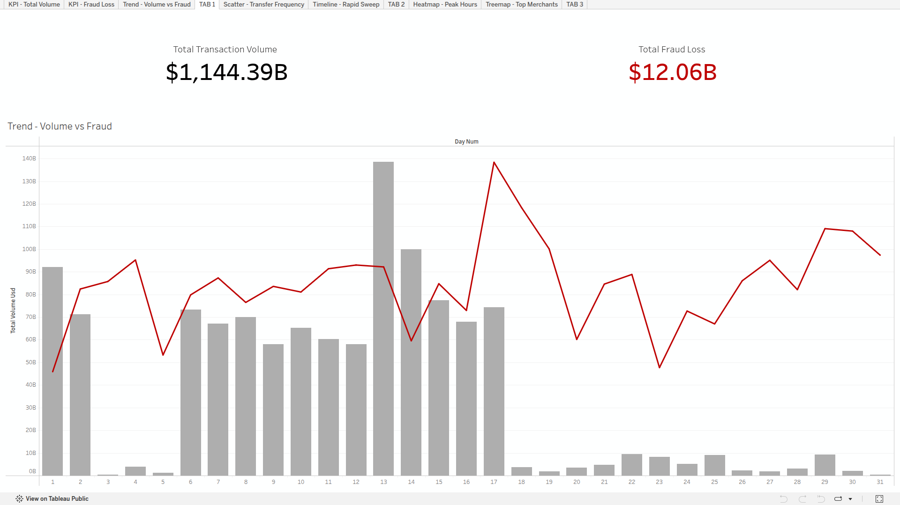
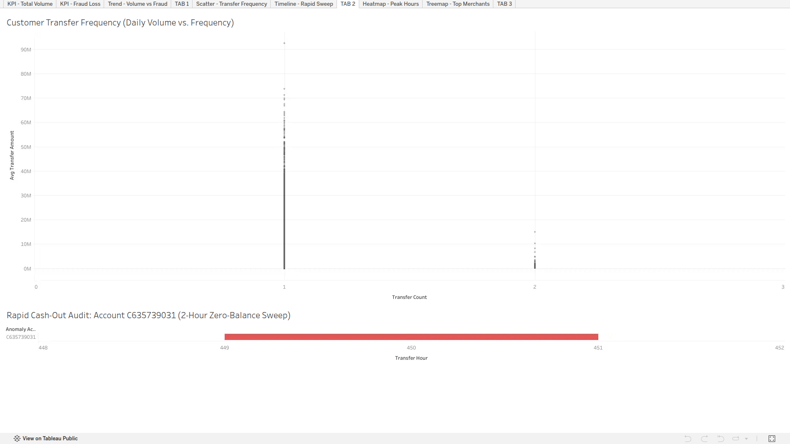
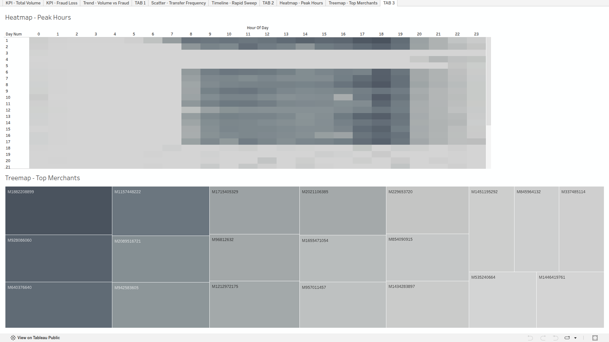

# PaySim Mobile Money Analytics & Fraud Analysis

An SQL and Tableau project exploring mobile money transactions, fraud patterns, and network activity using PostgreSQL.

**[View Interactive Dashboard on Tableau Public](https://public.tableau.com/views/PaySimMobileMoneyAnalytics/TAB1?:language=en-US&:sid=&:redirect=auth&:display_count=n&:origin=viz_share_link)**

---

## Project Overview

Mobile money services process large numbers of transactions every day. Understanding how money moves through these networks is important for monitoring transactions, identifying unusual activity, and maintaining reliable services.

This project explores a synthetic mobile money transaction dataset containing over 6.3 million records. Using PostgreSQL, I examined transaction patterns, account balances, fraud indicators, and money movement across the network.

The analysis was then presented through an interactive Tableau dashboard, making the findings easier to explore and understand.

## Project Objectives

The main objectives of this project were to:

- Explore transaction activity across different transaction types.
- Examine data quality and account balance movements.
- Analyse product-like transaction patterns, account activity, and fraud indicators.
- Identify unusual transaction sequences and potential fraud patterns.
- Evaluate the performance of the dataset's existing fraud flagging indicator.
- Present key findings through an interactive Tableau dashboard.

## Dataset

The project uses the **PaySim Mobile Money Transaction Dataset**, obtained from Kaggle.

- **Dataset:** [PaySim Data – Kaggle](https://www.kaggle.com/datasets/mtalaltariq/paysim-data)
- **Records:** 6,362,620 transactions
- **Fraud-labelled transactions:** 8,213
- **Time period:** 744 hourly steps (approximately 31 days)
- **Data type:** Synthetic mobile money transactions

PaySim was developed to simulate mobile money transactions based on patterns from an actual financial service. The dataset provides transaction records and fraud indicators for research and analysis.

### Dataset Columns

| Column | Description |
|---|---|
| `step` | Transaction time, where each step represents one hour. |
| `type` | Transaction type: CASH_IN, CASH_OUT, DEBIT, PAYMENT or TRANSFER. |
| `amount` | Transaction amount in the dataset's currency units. |
| `nameOrig` | Account initiating the transaction. |
| `oldbalanceOrg` | Origin account balance before the transaction. |
| `newbalanceOrig` | Origin account balance after the transaction. |
| `nameDest` | Destination account. |
| `oldbalanceDest` | Destination account balance before the transaction. |
| `newbalanceDest` | Destination account balance after the transaction. |
| `isFraud` | Indicates whether the transaction is labelled as fraudulent. |
| `isFlaggedFraud` | Indicates whether the transaction was flagged by the dataset's existing rule. |

## Tools & Technologies

| Tool | Purpose |
|---|---|
| PostgreSQL | Database creation, storage and SQL analysis. |
| DBeaver | Database management and SQL development. |
| SQL | Data exploration, preparation and analytical queries. |
| Tableau Public | Interactive dashboards and data visualization. |

### SQL Concepts Used

- Common Table Expressions (CTEs)
- Window Functions (`LEAD`)
- Aggregate Functions (`COUNT`, `SUM`, `AVG`)
- Conditional Logic (`CASE`)
- Database Views
- B-Tree Indexing
- Expression Indexing
- Data Filtering and Grouping
- Date and Time Calculations

## Project Workflow

The project followed a series of steps, from database preparation to dashboard development.

### 1. Database Setup and Data Import

Created a PostgreSQL database and designed a table to store the transaction records.

The monetary columns were defined using `DECIMAL(18,2)` to maintain numerical precision. Indexes were also added to frequently queried columns to support analytical queries.

### 2. Data Exploration

Explored the dataset to understand its structure and transaction activity.

The analysis included:

- Counting transactions by type.
- Comparing transaction volumes and average amounts.
- Examining account balance movements.
- Checking for differences between expected and recorded balance changes.
- Comparing actual fraud labels with the existing flagging indicator.

### 3. Data Preparation

Prepared the transaction data for further analysis.

Since each `step` represents one hour, additional time dimensions were needed to examine activity by day and hour.

An initial attempt to update the original table with calculated time columns was too slow. I changed the approach and created a PostgreSQL view to calculate these values when queried.

I also created a separate view containing TRANSFER and CASH_OUT transactions to make the fraud analysis easier to manage.

### 4. Fraud and Transaction Analysis

Used SQL queries to investigate transaction behaviour and potential anomalies.

The analysis focused on:

- Sequential transfers and cash-outs.
- Accounts with multiple transfers within a day.
- Confirmed fraudulent transactions.
- Daily fraudulent cash-out amounts.
- Differences between fraud labels and existing system flags.

CTEs and window functions were particularly useful for examining transaction sequences and account activity.

### 5. Data Extraction

Prepared five analytical datasets from PostgreSQL for use in Tableau:

| Dataset | Purpose |
|---|---|
| `hourly_network_summary.csv` | Hourly transaction activity and fraud trends. |
| `confirmed_fraud_details.csv` | Details of transactions labelled as fraudulent. |
| `merchant_daily_volume.csv` | Daily transaction volumes by merchant. |
| `rapid_cashout_anomalies.csv` | Transaction sequences matching the selected rapid cash-out conditions. |
| `customer_transfer_frequency.csv` | Transfer frequency and average transaction amounts by account. |

Using prepared datasets allowed the Tableau dashboard to work with focused analytical results instead of repeatedly querying the full transaction table.

### 6. Tableau Dashboard Development

Connected the exported datasets to Tableau Public and developed three dashboard tabs.

The dashboard presents the findings from different perspectives, covering overall network activity, fraud patterns, and merchant operations.

## Key Findings

The analysis produced several interesting findings from the dataset.

### 1. Existing Fraud Flagging Performance

A comparison of `isFraud` and `isFlaggedFraud` revealed a significant difference between the two indicators.

- Total fraud-labelled transactions: **8,213**
- Transactions also flagged by the existing indicator: **16**
- Fraud-labelled transactions not flagged: **8,197**

This means approximately 99.8% of the fraud-labelled transactions were not flagged by the existing indicator.

The result highlights the limitations of the flagging approach represented in this synthetic dataset.

### 2. Rapid Transfer and Cash-Out Pattern

Using the SQL `LEAD()` window function, I examined sequential transactions made by the same origin account.

One account matched the selected conditions:

- Account: `C635739031`
- Initial transfer amount: 1,965,786.11
- Following cash-out amount: 234,007.52
- Time between transactions: 2 hours

This was an unusual transaction sequence worth investigating further.

### 3. Transfer Frequency Analysis

I examined the number of transfers made by each origin account within a simulated day.

The query returned no accounts with three or more transfers in the same day.

This provides an interesting view of transfer frequency within the dataset, although it does not establish that accounts were abandoned or that all transactions followed a particular fraud strategy.

### 4. Daily Fraudulent Cash-Out Activity

The analysis also examined confirmed fraudulent CASH_OUT transactions across the simulated period.

The results showed:

- Total confirmed fraudulent cash-out value: approximately **5.99 billion dataset currency units**.
- Highest daily cash-out value: approximately **316 million dataset currency units**.
- Lowest daily cash-out value: approximately **105 million dataset currency units**.

These figures show how fraudulent cash-out activity varied throughout the simulated period.

## Tableau Dashboard

The analysis is presented in three interactive dashboard tabs.

**Explore the complete dashboard: [PaySim Mobile Money Analytics – Tableau Public](https://public.tableau.com/views/PaySimMobileMoneyAnalytics/TAB1?:language=en-US&:sid=&:redirect=auth&:display_count=n&:origin=viz_share_link)**

### Tab 1: Executive Overview

Provides an overall view of network activity, transaction volume, and fraud-related financial exposure.

[](https://public.tableau.com/views/PaySimMobileMoneyAnalytics/TAB1?:language=en-US&:sid=&:redirect=auth&:display_count=n&:origin=viz_share_link)

### Tab 2: Fraud Forensics

Explores unusual transaction patterns, transfer frequency, and rapid cash-out activity identified during the SQL analysis.

[](https://public.tableau.com/views/PaySimMobileMoneyAnalytics/TAB2?:language=en-US&:sid=&:redirect=auth&:display_count=n&:origin=viz_share_link)

### Tab 3: Operations & Liquidity

Presents transaction activity across different hours and days, together with merchant transaction volumes.

[](https://public.tableau.com/views/PaySimMobileMoneyAnalytics/TAB3?:language=en-US&:sid=&:redirect=auth&:display_count=n&:origin=viz_share_link)

## Repository Structure

```text
PaySim-Mobile-Money-Analytics/
│
├── README.md
├── .gitignore
│
├── sql/
│   ├── 01_schema_setup.sql
│   ├── 02_ledger_forensics.sql
│   ├── 03_operational_views.sql
│   ├── 04_fraud_heuristics.sql
│   └── 05_tableau_exports.sql
│
├── data/
│   ├── confirmed_fraud_details.csv
│   ├── customer_transfer_frequency.csv
│   ├── hourly_network_summary.csv
│   ├── merchant_daily_volume.csv
│   └── rapid_cashout_anomalies.csv
│
└── assets/
    ├── tab1_macro_view.png
    ├── tab2_fraud_forensics.png
    └── tab3_operations_heatmap.png
```

The original dataset is not included in this repository because of its large file size. It can be obtained from the Kaggle dataset link provided above.

## How to Run the Project

To explore the SQL analysis locally:

1. Install PostgreSQL and DBeaver.
2. Download the dataset from Kaggle.
3. Create a PostgreSQL database named `paysim_db`.
4. Create the transaction table using the database setup SQL script.
5. Import the downloaded CSV file into the table.
6. Execute the SQL scripts in their intended order.
7. Use the exported analytical CSV files as data sources in Tableau.

The Tableau dashboard can also be explored directly through the public link without setting up the database locally.

## Project Limitations

A few points should be considered when interpreting the findings:

- PaySim is a synthetic dataset, not a collection of actual customer transactions.
- The fraud findings reflect the labels provided in the dataset.
- The transfer frequency analysis uses daily grouping rather than a true rolling 24-hour window.
- The rapid cash-out query identifies transactions matching specific conditions; it does not independently confirm criminal activity.
- The analysis does not include a machine learning model or a deployed fraud detection system.

## Conclusion

This project provided an opportunity to work with a large transaction dataset and explore how SQL can be used to investigate financial activity.

From database setup and query optimization to transaction analysis and Tableau visualization, the project covered several stages of a practical data analysis workflow.

It also demonstrated how analytical findings can be presented in a way that makes large datasets easier to understand and explore.

---

**Author:** Dionis Ludovick Nasuwa

*Data Analyst | BSc. Computer Science*

[GitHub](https://github.com/dionis36/) · [LinkedIn](https://linkedin.com/in/dionis-nasuwa/)
